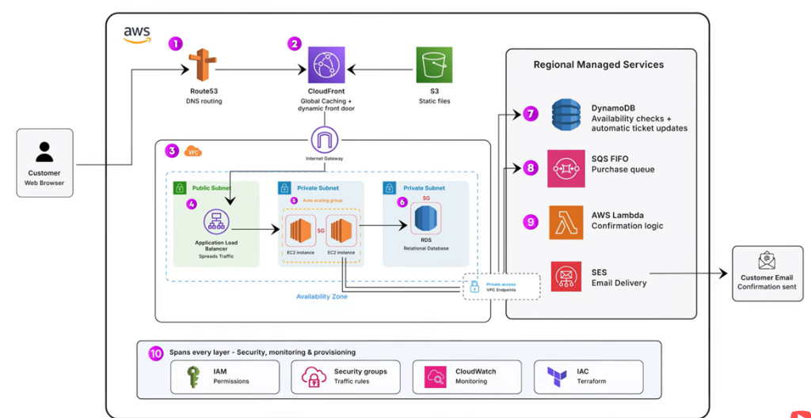
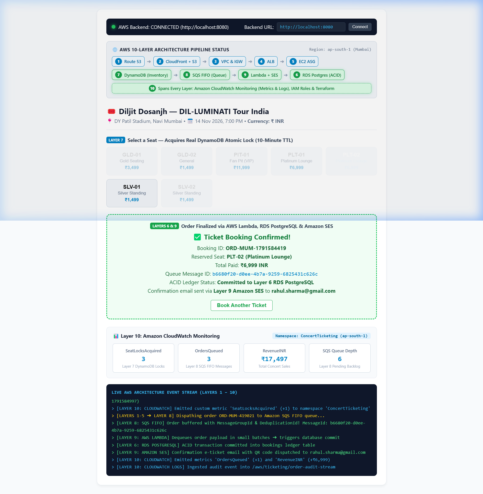

# High-Scale AWS Concert Ticketing System

An event-driven ticket booking architecture built on AWS to handle massive flash-sale traffic spikes with zero overselling, zero database crashes, and full end-to-end CloudWatch observability.

---

## Architecture Overview



### Live 10-Layer System Preview


---

## AWS 10-Layer Architecture Mapping

| Layer # | AWS Service | Role in This Application |
|:---:|:---|:---|
| **1** | **Amazon Route 53** | Global DNS routing, latency-based routing & automated health checks. |
| **2** | **Amazon CloudFront & S3** | Global CDN edge caching & static frontend asset distribution. |
| **3** | **AWS VPC & Internet Gateway** | Virtual Private Cloud network boundary isolating public & private subnets. |
| **4** | **Application Load Balancer (ALB)** | Public subnet ingress distributor, TLS termination & path routing. |
| **5** | **EC2 Auto Scaling Group (ASG)** | Private subnet backend API compute fleet (`backend-api/server.py`). |
| **6** | **Amazon RDS PostgreSQL** | Relational ACID financial database committing permanent order records. |
| **7** | **Amazon DynamoDB** | High-throughput inventory checks and **10-minute atomic conditional locks**. |
| **8** | **Amazon SQS FIFO** | Zero-loss, strictly ordered, deduplicated purchase order buffer queue. |
| **9** | **AWS Lambda & Amazon SES** | Async worker consuming SQS batches + dispatching e-ticket emails with QR codes. |
| **10** | **Amazon CloudWatch (Spans All Layers)** | Monitoring custom metrics (`SeatLocksAcquired`, `OrdersQueued`, `RevenueINR`) & audit logs across all layers. |

---

## Deep Dive: How Application Load Balancer (ALB) Works & Detects Traffic Surges

### 1. How ALB Works in the Request Path (Layer 4)
* **Public Subnet Gateway**: ALB resides in a public subnet across multiple Availability Zones (AZs) behind an Internet Gateway. It acts as the single public entry point for all API requests.
* **Layer 7 Intelligent Routing**: Operating at the Application Layer (HTTP/HTTPS), ALB inspects incoming requests and routes them to target groups based on paths (e.g. `/api/*` routed to the EC2 backend cluster, static content offloaded to CloudFront/S3).
* **Least Outstanding Requests Balancing**: ALB continuously directs new connections to the EC2 instance with the fewest active pending requests, preventing any single server from getting overwhelmed.
* **Continuous Health Checking**: ALB constantly pings `GET /health` on every registered EC2 instance (e.g. every 15 seconds). If an instance fails or hangs, ALB immediately removes it from the routing rotation in under 5 seconds.

---

### 2. How ALB Auto-Scales Itself During a Flash Sale
* ALB is a managed AWS service. Behind the scenes, ALB is **not a single server**—it is a fleet of elastic load balancer nodes managed by AWS.
* As incoming HTTP requests per second (RPS) ramp up, AWS automatically provisions additional load balancer capacity behind the ALB DNS name.
* **Pre-Warming**: For known mega-ticket drops (e.g. 500,000 fans hitting the site at 12:00 PM sharp), AWS can pre-warm the ALB so all frontend nodes are initialized ahead of the spike.

---

### 3. How ALB Knows When "Too Many People Come" (Auto Scaling Trigger)
ALB measures traffic volume and server pressure using real-time **Amazon CloudWatch metrics**:

1. **`RequestCountPerTarget`**:
   * ALB continuously calculates: `Total Requests / Number of Healthy EC2 Instances`.
   * If 2 backend instances are running and suddenly 4,000 requests arrive per minute, `RequestCountPerTarget` jumps from 100 to 2,000.
2. **`TargetResponseTime`**:
   * Measures the time elapsed (in milliseconds) between when ALB forwards a request to an EC2 instance and when it receives the response.
   * If CPU becomes saturated, response times spike (e.g. from 12ms to 850ms).
3. **Triggering EC2 Auto Scaling (Layer 5)**:
   * We attach a **Target Tracking Scaling Policy** to the EC2 Auto Scaling Group (ASG):
     ```
     Target metric: ALBRequestCountPerTarget
     Target value: 500 requests per target
     ```
   * As soon as CloudWatch detects that `RequestCountPerTarget > 500`, it immediately signals the ASG to scale out from 2 instances to 10, 20, or 50 instances.
4. **Zero Downtime Registration**:
   * As new EC2 instances boot up in private subnets, the ASG registers them with the ALB Target Group.
   * ALB runs health checks on them. Once healthy, ALB instantly begins spreading incoming connections across the enlarged fleet.

---

## How It Works (Step-by-Step Ticketing Flow)

1. **Browse Live Inventory (Layer 7 DynamoDB)**:
   The user opens the web app. Available seats and pricing in ₹ INR are queried directly from **Amazon DynamoDB**.
2. **Atomic 10-Minute Hold (Layer 7 DynamoDB)**:
   Clicking a seat sends an atomic conditional update to DynamoDB:
   - If available, DynamoDB marks the seat as `LOCKED` and sets a 10-minute TTL (`lockExpiresAt`).
   - If thousands of fans click the same seat at once, only the first request succeeds; all other requests are rejected in < 5ms without touching the relational database.
   - If unpaid after 10 minutes, DynamoDB TTL automatically releases the seat back to the pool.
3. **Queue-Buffered Checkout (Layer 8 SQS FIFO)**:
   Submitting the booking sends the order payload to **Amazon SQS FIFO**:
   - SQS ensures strict First-In-First-Out ordering and deduplicates requests to prevent accidental double-charges.
   - The backend responds immediately with `202 Accepted`, protecting servers from crashing under sudden surges.
4. **Database Commit (Layer 6 RDS PostgreSQL & Layer 9 Lambda)**:
   An **AWS Lambda** worker pulls orders from the SQS queue in small, steady batches and commits the order into **Amazon RDS PostgreSQL** inside a safe transaction.
5. **Permanent Allocation (Layer 7 DynamoDB)**:
   Lambda updates the seat state in DynamoDB from `LOCKED` to permanently `SOLD`.
6. **E-Ticket Delivery (Layer 9 Amazon SES)**:
   Lambda invokes **Amazon SES** to send an official confirmation email containing the attendee pass and entry QR code.
7. **Real-Time Telemetry & Monitoring (Layer 10 Amazon CloudWatch)**:
   - Emits custom metrics under the **`ConcertTicketing`** namespace: `SeatLocksAcquired`, `OrdersQueued`, and `RevenueINR`.
   - Tracks SQS backlog queue depth (`ApproximateNumberOfMessages`) in real-time to monitor buffer load.
   - Aggregates operational logs in CloudWatch Logs for audit compliance.

---

## Project Structure

```
├── assets/
│   ├── aws_reference_architecture.png   # 10-layer reference architecture diagram
│   └── live_system_preview.png          # Live verified web application screenshot
├── frontend/
│   └── index.html                       # Booking UI with 10-layer pipeline visualizer & metrics
├── backend-api/
│   ├── server.py                        # Python Boto3 API (DynamoDB + SQS FIFO + CloudWatch)
│   ├── .env                             # AWS credentials & region configuration
│   └── src/                             # Node.js alternative backend
├── lambda-order-processor/
│   ├── index.js                         # SQS FIFO consumer handler
│   ├── db.js                            # RDS PostgreSQL ACID transaction
│   └── emailService.js                  # Amazon SES ticket dispatcher
├── terraform-simple/
│   └── main.tf                          # All-in-one single-file Terraform script
└── scripts/
    └── setup_aws_cloud.py               # Instant cloud provisioning script
```

---

## Quickstart (Run with Real AWS)

### 1. Prerequisites
- Python 3.10+
- AWS Account with an IAM Access Key

### 2. Configure Credentials
Edit `backend-api/.env`:
```env
AWS_REGION=ap-south-1
AWS_ACCESS_KEY_ID=your_access_key
AWS_SECRET_ACCESS_KEY=your_secret_key
DYNAMODB_TABLE_NAME=TicketInventory
SQS_QUEUE_URL=https://sqs.ap-south-1.amazonaws.com/<account-id>/ticket-purchases.fifo
```

### 3. Provision AWS Resources (DynamoDB & SQS)
```bash
python scripts/setup_aws_cloud.py
```

### 4. Start the Backend Server
```bash
cd backend-api
python server.py
```
Server runs on `http://localhost:8080`.

### 5. Open the Web Application
Open `http://localhost:8080/` in any browser to experience:
- Live 10-Layer Architecture Pipeline Status.
- Real-time seat inventory from AWS DynamoDB.
- 10-minute atomic locks with DynamoDB `ConditionExpression`.
- Purchases dispatched to Amazon SQS FIFO.
- Live **CloudWatch Metrics** (`SeatLocksAcquired`, `OrdersQueued`, `RevenueINR`, `SQS Queue Depth`).
